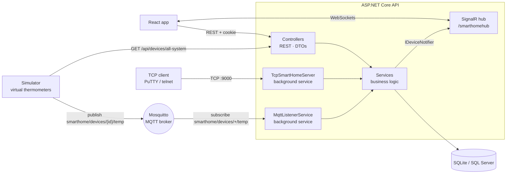

# Smart Home Simulator

[](https://github.com/jakub-jurkian/smart-home-simulator/actions/workflows/ci.yml)

*A full-stack IoT platform that simulates connected home devices over MQTT, TCP and SignalR.*

| | |
|---|---|
| **Run it** | `docker compose up --build`, then open `http://localhost:5173` - there is no live demo |
| **API docs** | Swagger UI at `http://localhost:5000/swagger` once running |
| **Stack** | .NET 10, ASP.NET Core, EF Core, MQTTnet, SignalR, React 19, TypeScript, Docker Compose |


> Built as a university project for the *Protokoły sieci Web* (Web Network Protocols) course, to practise
> several network protocols in one system: HTTP/REST, WebSockets (SignalR), MQTT and a raw TCP socket.
> It was previously deployed to Microsoft Azure (Container Apps, Static Web App, Azure SQL Database,
> Container Registry) with the infrastructure defined in Bicep. That deployment has been retired.

## Overview

Users register, create rooms, and add devices to them - light bulbs they can switch on and off, and
temperature sensors that report readings. Each user sees and controls only their own rooms and devices,
and can keep a maintenance log per device.

The same devices can be reached over four protocols, each used where it fits:

- **HTTP/REST** - the React app manages users, rooms, devices and maintenance logs.
- **MQTT** - a separate simulator service acts as the physical thermometers, publishing a reading for
  every sensor every 5 seconds.
- **WebSockets (SignalR)** - the API pushes new readings and device changes to open browsers, so the
  dashboard updates without refreshing.
- **Raw TCP** - a text console on port `9000` (`LOGIN`, `LIST`, `TOGGLE`, `EXIT`), usable from PuTTY or
  `telnet`.

## Tech Stack

| Technology | Why it's here |
|---|---|
| **.NET 10 & ASP.NET Core** | REST controllers, background services and the SignalR hub in one host. |
| **EF Core** | Data access; SQLite locally and in tests, SQL Server outside Development. |
| **EF Core TPH inheritance** | Light bulbs and temperature sensors share one `Devices` table with a discriminator. |
| **MQTTnet + Eclipse Mosquitto** | The simulator publishes readings; the API subscribes to them through the broker. |
| **SignalR** | Pushes temperatures and device changes to the browser in real time. |
| **`TcpListener`** | A raw TCP text protocol with its own per-connection login state. |
| **Cookie authentication + BCrypt** | `HttpOnly` session cookie; passwords stored as salted BCrypt hashes. |
| **Serilog** | Structured request and application logs, written to the console and to files. |
| **React 19, TypeScript, Tailwind CSS v4** | The dashboard, built with Vite. |
| **xUnit, Moq, Reqnroll, NBomber** | Unit, integration, BDD and load tests. |
| **Docker & Docker Compose** | The broker, API, simulator and frontend with one command. |
| **GitHub Actions** | CI builds and tests the backend, builds the Docker images and the frontend on every push and PR. |

## Architecture



**The flow of a temperature reading**

1. The simulator fetches the list of all sensors from the API.
2. For each one it publishes `{"temperature": 21.37}` to `smarthome/devices/{deviceId}/temp`.
3. `MqttListenerService`, subscribed with the wildcard `smarthome/devices/+/temp`, takes the device ID
   from the topic and saves the reading.
4. The notifier pushes `ReceiveTemperature(deviceId, value)` over SignalR, and the dashboard updates.

**The layers**

- **Domain** - entities (`Device`, `LightBulb`, `TemperatureSensor`, `Room`, `User`, `MaintenanceLog`)
  and the repository, service and notifier interfaces. No framework dependencies.
- **Infrastructure** - EF Core `DbContext`, migrations, repositories and service implementations.
- **Api** - controllers, DTOs, the SignalR hub and the TCP and MQTT background services. It is the only
  layer that knows about HTTP, sockets or the broker.

## Engineering Decisions

- **Clean Architecture boundaries.** Services depend on interfaces from `Domain`; the API supplies the
  concrete `SignalRNotifier`, so business logic can raise "device changed" without knowing about SignalR.
- **Device polymorphism in one table.** EF Core Table-Per-Hierarchy stores both device types in one
  table, and behaviour lives on the entity (`TurnOn()`, `SetTemperature()`) rather than in the service.
- **The device ID travels in the MQTT topic.** One wildcard subscription covers every sensor, and the
  payload stays a tiny JSON object.
- **Background services share the app's logic.** The TCP server and the MQTT listener create a DI scope
  per message or command and call the same services as the controllers, so all three entry points follow
  the same rules.
- **Stateful TCP sessions.** Each TCP connection keeps its own logged-in user; `LIST` and `TOGGLE` are
  refused until `LOGIN` succeeds, and only the user's own devices are listed.
- **Resilient MQTT connection.** The listener retries every 5 seconds until the broker is up and
  reconnects after a disconnect, so container start order does not matter.
- **Cookies, not tokens in storage.** Login issues an `HttpOnly` cookie; unauthenticated API calls get a
  `401` instead of a redirect to a login page.
- **Data scoped per user.** Rooms and devices carry a `UserId`, and every lookup filters by the signed-in
  user's ID from the cookie.
- **Small runtime images.** Multi-stage Docker builds ship only the ASP.NET runtime (~200 MB instead of
  ~800 MB with the SDK).

## Testing

```bash
dotnet test   # unit, integration and BDD suites
```

- **Unit tests** (43, `xUnit` + `Moq`) - domain rules and the device, room, user and maintenance-log
  services.
- **Integration tests** (40) - every controller over HTTP through `WebApplicationFactory`, against an
  in-memory SQLite database.
- **BDD** (`Reqnroll` / Gherkin) - a device-control scenario written in plain language.
- **Load test** (`NBomber`) - 50 concurrent virtual users calling `GET /api/rooms` for 30 seconds. It
  runs separately, against an API started with `dotnet run`:

```bash
dotnet run --project tests/SmartHome.PerformanceTests
```

## Trade-offs and Known Limitations

- **SignalR broadcasts to everyone.** Updates go to `Clients.All`, so every open browser receives every
  sensor's readings (by device ID). Per-user SignalR groups would fix this.
- **`/api/devices/all-system` is public.** The simulator needs the list of sensors without logging in,
  so this endpoint returns every device in the system. A service account or API key would close it.
- **The broker allows anonymous clients** and nothing is encrypted - MQTT, the TCP console (including
  `LOGIN` passwords) and local HTTP all travel in plain text. Fine for a local simulation, not for real
  devices; TLS and broker credentials would come first.
- **The schema is created with `EnsureCreated()`** at startup, even though migrations exist. Simple for
  a demo, but schema changes would need the migrations applied instead.
- **Only two device types**, and the simulator only produces temperature readings.
- **No live demo** since the Azure deployment was retired.

## Running Locally

Requires Docker and Docker Compose.

```bash
docker compose up --build
```

| Service | Address |
|---|---|
| Frontend | `http://localhost:5173` |
| API / Swagger | `http://localhost:5000/swagger` |
| TCP console | `localhost:9000` |
| MQTT broker | `localhost:1883` (TCP) · `localhost:9001` (WebSockets) |

Try the TCP console once you have registered an account in the app:

```bash
telnet localhost 9000
```